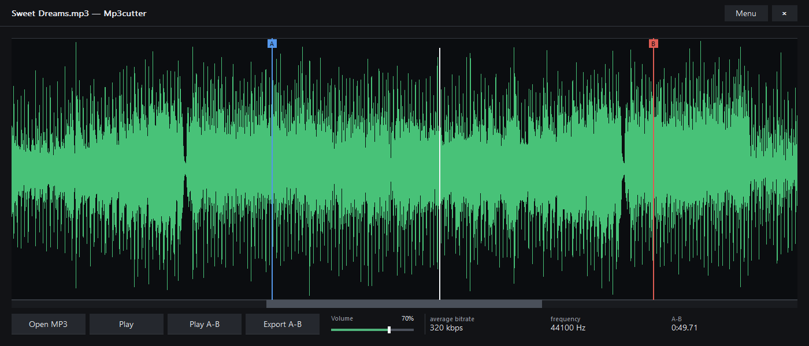

<p align="center">
  
</p>

<h1 align="center">Mp3cutter</h1>

<p align="center">
  A native Win32 MP3 player with A-B range export without re-encoding.
</p>

<p align="center">
  
</p>

## Features

- Plays MP3 files through BASS and WASAPI.
- Displays a waveform with seek, zoom, pan, cursor, and A-B controls.
- Exports a selected range by copying complete MP3 frames.
- Does not decode, re-encode, apply effects, or change the volume during export.
- Loads waveforms and exports files on background threads.
- Uses a DPI-aware, double-buffered GDI interface.

## Requirements

- Windows 10 or 11, x64.
- Visual Studio 2026 with the x64 C++ build tools.
- 64-bit BASS 2.4, BASSmix 2.4, and BASSWASAPI 2.4 SDKs.
- CMake 3.24 or newer only when using the CMake build.

Download the audio SDKs from [un4seen.com](https://www.un4seen.com/). The BASS
SDK is kept in the local `Bass\` directory and is excluded from Git, so each
user can obtain it separately under the applicable license.

The default SDK layout inside the project is:

```text
ExportProject/
`-- Bass/
    |-- bass24/
    |   |-- c/
    |   |   |-- bass.h
    |   |   `-- x64/bass.lib
    |   `-- x64/bass.dll
    |-- bassmix24/
    |   |-- c/
    |   |   |-- bassmix.h
    |   |   `-- x64/bassmix.lib
    |   `-- x64/bassmix.dll
    `-- basswasapi24/
        |-- c/
        |   |-- basswasapi.h
        |   `-- x64/basswasapi.lib
        `-- x64/basswasapi.dll
```

## Build

Open a terminal in the project directory and run:

```bat
build.bat
```

To use a different SDK location:

```bat
set BASS_DIR=C:\path\to\Bass
build.bat
```

The executable and the three required BASS DLLs are written to `bin\`.

The project can also be built with CMake:

```bat
cmake -S . -B build -DBASS_DIR=C:\path\to\Bass
cmake --build build --config Release
```

## Run

```bat
bin\Mp3cutter.exe
```

Open a file at startup by passing its path:

```bat
bin\Mp3cutter.exe "C:\Music\track.mp3"
```

The `Menu` button opens the settings panel. Settings are saved next to
`Mp3cutter.exe` in `settings.txt`.

## Export behavior

The exported file contains the original MP3 data. A-B boundaries are aligned to
complete MP3 frames, so they can differ slightly from the selected time. No
additional compression, volume adjustment, or audio effect is applied.

## Testing

The smoke test builds a waveform, exports a range, and reopens the result
through BASS. A test MP3 is not included; provide a file you are allowed to use:

```bat
tests\build_smoke.bat
tests\core_smoke.exe "C:\Music\track.mp3" "%TEMP%\range.mp3" 0.15 0.35
```

Build output, the local `Bass\` SDK, test media, exported files, and local
editor settings are ignored by Git.

## Third-party software

BASS, BASSmix, and BASSWASAPI are products of Un4seen Developments. The local
`Bass\` directory is not distributed with this repository and is not covered by
this project's MIT license. Review the current
[Un4seen BASS licensing terms](https://www.un4seen.com/bass.html#license)
before distributing a built application. See
[THIRD_PARTY_NOTICES.md](THIRD_PARTY_NOTICES.md) for details.

## License

Copyright (c) 2026 Дмитрий (ds860813-sys).

Mp3cutter is available under the [MIT License](LICENSE).
