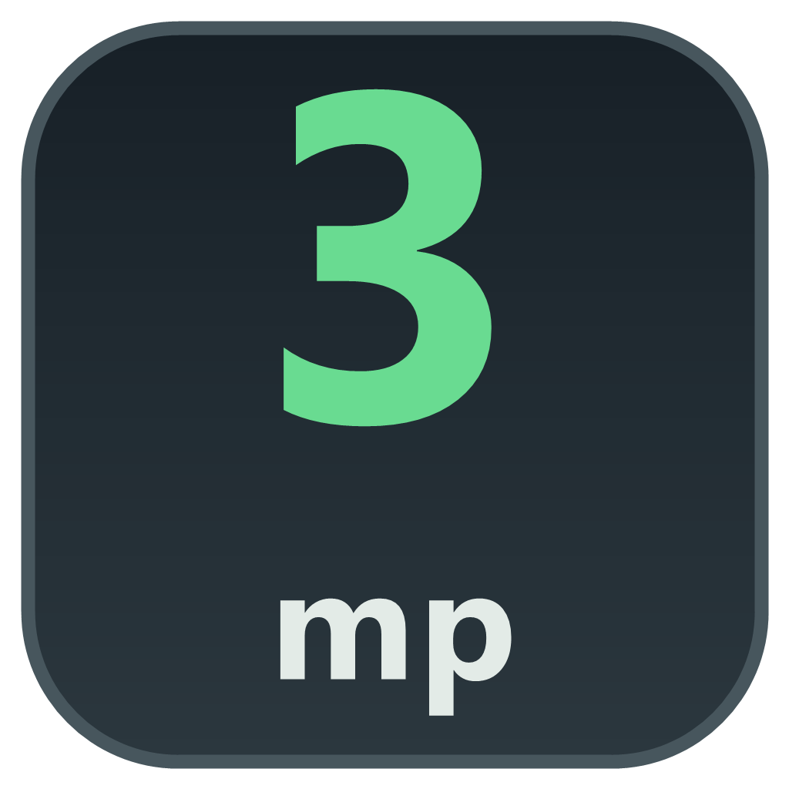

<p align="center">
  
</p>

<h1 align="center">Mp3cutter</h1>

<p align="center">
  A native Win32 MP3 player with A-B range export without re-encoding.
</p>

<p align="center">
  
</p>

## What it does

Mp3cutter is a small Windows desktop program for selecting an A-B range in an
MP3 file and exporting that range quickly. Export copies the original MP3
frames without decoding or re-encoding the audio.

## Download and run

The repository provides a 64-bit Windows executable:

- [Download Mp3cutter.exe](dist/Mp3cutter.exe)

The BASS DLLs are not included. Download the current 64-bit SDK packages
directly from Un4seen:

| Package | Download | DLL needed |
| --- | --- | --- |
| BASS 2.4 | [bass24.zip](https://www.un4seen.com/files/bass24.zip) | `x64\bass.dll` |
| BASSmix 2.4 | [bassmix24.zip](https://www.un4seen.com/files/bassmix24.zip) | `x64\bassmix.dll` |
| BASSWASAPI 2.4 | [basswasapi24.zip](https://www.un4seen.com/files/basswasapi24.zip) | `x64\basswasapi.dll` |

Create one folder and place `Mp3cutter.exe` and all three DLLs directly inside
it:

```text
Mp3cutter\
|-- Mp3cutter.exe
|-- bass.dll
|-- bassmix.dll
`-- basswasapi.dll
```

All DLLs must be the x64 versions. Do not copy them into `C:\Windows\System32`
and do not rename them. Run `Mp3cutter.exe` by double-clicking it, or from
PowerShell:

```powershell
.\Mp3cutter.exe
```

Settings are created in `settings.txt` next to the executable. The development
build is not code-signed, so Windows SmartScreen may display a warning. Verify
that the executable was downloaded from this repository.

BASS has its own license and is not covered by this project's MIT license. See
[THIRD_PARTY_NOTICES.md](THIRD_PARTY_NOTICES.md) and the official
[Un4seen licensing terms](https://www.un4seen.com/bass.html#license).

## Using the program

1. Click `Open MP3`, or pass a file path when starting the program.
2. Click the waveform to move the playback cursor.
3. Use the mouse wheel over the waveform to zoom.
4. Hold `Shift` and use the mouse wheel to pan a zoomed waveform.
5. Right-click the waveform and choose `Set A here` or `Set B here`.
6. Use `Play A-B` to audition the selected range.
7. Click `Export A-B` to create an MP3 containing the selected range.

Markers can also be adjusted by dragging them horizontally.

## Export behavior

The exported file contains the original MP3 data. A-B boundaries are aligned to
complete MP3 frames, so they can differ slightly from the selected time. No
additional compression, volume adjustment, or audio effect is applied.

## Build from source

### Requirements

- Windows 10 or 11, x64.
- Visual Studio 2022 or newer with the x64 C++ build tools and Windows SDK.
- 64-bit BASS 2.4, BASSmix 2.4, and BASSWASAPI 2.4 SDKs.
- CMake 3.24 or newer only when using the CMake build.

Download `bass24.zip`, `bassmix24.zip`, and `basswasapi24.zip` from
[un4seen.com](https://www.un4seen.com/). Extract them inside the project using
the following layout:

```text
ExportProject/
`-- Bass/
    |-- bass24/
    |   |-- c/
    |   |   |-- bass.h
    |   |   `-- x64/bass.lib
    |   `-- x64/bass.dll
    |-- bassmix24/
    |   |-- c/
    |   |   |-- bassmix.h
    |   |   `-- x64/bassmix.lib
    |   `-- x64/bassmix.dll
    `-- basswasapi24/
        |-- c/
        |   |-- basswasapi.h
        |   `-- x64/basswasapi.lib
        `-- x64/basswasapi.dll
```

The `Bass\` directory is excluded from Git because it contains third-party SDK
files.

### Build with build.bat

Open a Command Prompt in the project directory and run:

```bat
build.bat
```

To use a different SDK location:

```bat
set BASS_DIR=C:\path\to\Bass
build.bat
```

From PowerShell:

```powershell
$env:BASS_DIR = "C:\path\to\Bass"
cmd /c build.bat Release
```

The executable and the three runtime DLLs are written to `bin\`.

### Build with CMake

```bat
cmake -S . -B build -DBASS_DIR=C:\path\to\Bass
cmake --build build --config Release
```

Open a file at startup by passing its path:

```powershell
.\bin\Mp3cutter.exe "C:\Music\track.mp3"
```

### Testing

The smoke test builds a waveform, exports a range, and reopens the result
through BASS. A test MP3 is not included; provide a file you are allowed to use:

```powershell
tests\build_smoke.bat
tests\core_smoke.exe "C:\Music\track.mp3" "$env:TEMP\range.mp3" 0.15 0.35
```

Build output, the local `Bass\` SDK, test media, exported files, and editor
settings are ignored by Git. The ready-to-use executable in `dist\` is the only
tracked build artifact.

## Third-party software

BASS, BASSmix, and BASSWASAPI are products of Un4seen Developments. The local
`Bass\` directory is not distributed with this repository and is not covered by
this project's MIT license. Review the current
[Un4seen BASS licensing terms](https://www.un4seen.com/bass.html#license)
before distributing a built application. See
[THIRD_PARTY_NOTICES.md](THIRD_PARTY_NOTICES.md) for details.

## License

Copyright (c) 2026 Дмитрий (ds860813-sys).

Mp3cutter is available under the [MIT License](LICENSE).
